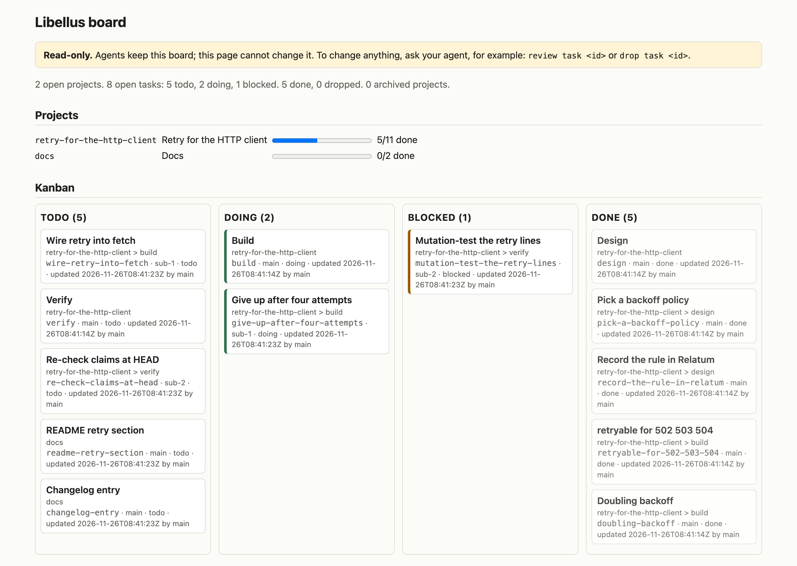

# Libellus

[](LICENSE)

Libellus is a private notepad and cost ledger for an AI agent, so it does not
lose track of its work when its conversation is compacted.

When a long session gets compacted (the earlier conversation squashed into a
summary), an agent tends to forget the question it was still unsure about,
the approach it already ruled out, the decision it made, and how much the run
has cost so far. Libellus keeps those in plain files that the agent owns.
After compaction, one command gives back a short brief to paste into the
session.

Each agent gets its own folder of short notes, plus a ledger of the tokens and
cost it reports. Notes can point at proof elsewhere (`tool:reference`) rather
than copying it. Sharing a note with other agents is a deliberate step into
[Relatum](https://github.com/IronAdamant/Relatum), not the default.

The one shared part is the **board**: a tree of tasks that a main agent and
its sub-agents keep together, so the plan survives compaction and finished
work tidies itself away. People read it as a page; agents change it.

<picture>
  <source media="(prefers-color-scheme: dark)" srcset="docs/images/board-dark.png">
  
</picture>

*The board page for a demo project: a main agent and two sub-agents (`sub-1`, `sub-2`) sharing one plan.*

What it deliberately does not do:

- **Call a model.** The agent reports its tokens and cost; Libellus only adds
  them up. Cost is a whole number of millionths of a US dollar (micro-USD).
- **Keep secrets.** "Private" means separate per agent. Anyone with access to
  the same computer account can read the files.
- **Do other tools' jobs.** Shared swarm notes are
  [Relatum](https://github.com/IronAdamant/Relatum), code memory is
  Stele-Context, per-file change notes are Wikifier, plans of code changes
  in dependency order, with verification, are
  [Trammel](https://github.com/IronAdamant/Trammel) (the board is the
  agents' own working task list, not that), live locks are
  CoordinationHub, and checking claims is
  [Adsertio](https://github.com/IronAdamant/Adsertio).

Libellus is one small Rust program with no dependencies beyond the standard
library. It works as a command line tool (`libellus`) and as an MCP server for
AI agents (`libellus-mcp`, or `libellus mcp`). There is no service and no
account.

## Install

Download the archive for your platform from the
[latest release](https://github.com/IronAdamant/Libellus/releases/latest):

| Platform | Archive |
|---|---|
| Linux x64 | `libellus-<version>-x86_64-unknown-linux-gnu.tar.gz` |
| macOS Intel | `libellus-<version>-x86_64-apple-darwin.tar.gz` |
| macOS Apple Silicon | `libellus-<version>-aarch64-apple-darwin.tar.gz` |
| Windows x64 | `libellus-<version>-x86_64-pc-windows-msvc.zip` |

Each archive holds `libellus` and `libellus-mcp`. Check the download against
`SHA256SUMS` before you run it. Libellus is not on crates.io or npm.

Or build it yourself (Rust 1.83 or newer):

```sh
git clone https://github.com/IronAdamant/Libellus
cd Libellus
cargo build --release --locked
```

The binaries land in `target/release/`.

## A quick tour

```sh
cd your-project
libellus init                                  # creates .libellus/ here

# Note a question, then answer it later.
libellus note --agent main --kind question --summary "Does retry apply to POST?"
libellus resolve --agent main --id does-retry-apply-to-post --outcome "No, GET only."
libellus get --agent main --id does-retry-apply-to-post

# Several notes in one call (an agent pays one turn, not one per note).
libellus note --agent main --notes-file notes.json

# Plan work on the shared board, then tick it off.
libellus plan --agent main --outline-file plan.md
libellus plan --agent main --ops '[{"set":{"id":"home-page","status":"done"}}]'
libellus board --agent main

# Record what a step cost, and see the totals.
libellus spend --agent main --task retry --tokens_in 100 --tokens_out 20 --cost_micro_usd 1000
libellus ledger --agent main

# The text to put back into the session after compaction.
libellus brief --agent main
```

Set `LIBELLUS_AGENT=main` and you can leave out `--agent`. (`libellus ledger`
is the exception: with no `--agent` it totals every agent.) Flags can be
written `--name value` or `--name=value`. A value that itself starts with `--`
is written `--name -- --value`.

The brief is plain text, short enough to paste straight back in:

```text
# Libellus brief for main

## Current state
- retry-wrapper-...: Retry wrapper is in src/http.rs; GET is done, POST next

## Board
- [~] relaunch > copy > about-page: About page
- [ ] relaunch > build > retry-post: Retry POST requests
- board: 4 todo, 2 doing, 0 blocked, 3 done, 0 dropped, 1 archived projects

## Open questions (1)
- does-retry-apply-to-put: Does retry apply to PUT?

## Recent decisions
- retry-only-idempotent-methods: Retry only idempotent methods

## Dead ends
- global-retry-middleware-...: Global retry middleware: breaks streaming uploads

## Costs
- total: 12000 in, 3000 out tokens, 45000 micro-USD (1 ledger entry)
- retry: 12000 in, 3000 out, 45000 micro-USD

Next: tick off a task with libellus_plan; resolve an open question with libellus_resolve; share a note with libellus_promote.
```

Each section is capped (5 items by default, `--max_items` up to 50), newest
first.

### Notes

Every note has a **kind**:

| Kind | Use it for |
|---|---|
| `context` | where things stand right now (the newest one is the brief's "Current state") |
| `decision` | a choice you made, and why |
| `question` | something still unsure; starts open until you resolve it |
| `dead-end` | an approach you tried and ruled out |
| `finding` | something you learned |

A note is `open` or `resolved`. Questions start open; other kinds start
resolved. To mark a decision as replaced, resolve it with `--supersede`, or
with an outcome that starts `SUPERSEDED:` or `REVERSED:`. Evidence is a
pointer such as `trammel:plan-3/step-2`, not a copy of the proof.

### The board

Notes are private. The board is shared by every agent in the store: one
file per task under `.libellus/board/`. The pattern is:

1. The main agent plans a project as a tree and hands subtrees to
   sub-agents by setting `owner` (`sub-2`).
2. Each sub-agent calls `libellus_brief` with its own agent name. Its open
   tasks are in the brief, with their place in the tree.
3. Each agent ticks off its tasks, several in one `libellus_plan` call.
4. When every child of a task is done or dropped (at least one done), the
   parent closes by itself, and so on up. When a project closes, it moves
   to `.libellus/board/archive/` and leaves the brief, so finished work does
   not pile up.

A plan can be an outline, a markdown checkbox list:

```markdown
- [ ] Relaunch
  - [ ] Copy
    - [x] Home page
    - [~] About page
  - [ ] Build
    - [ ] Retry POST requests
    - [!] Payment form
```

`[ ]` todo, `[~]` doing, `[!]` blocked, `[x]` done, `[-]` dropped; two
spaces or a tab per level, at most six levels. Ids come from the titles
(`about-page`) and are returned. A mistake in a line is an error naming the
line, and nothing is written.

The rules: a task cannot be done while a child is open; dropping a task
drops its open children; reopening a child reopens the parents that closed
by themselves; `remove` is only for a todo task added by mistake.
Any agent may change any task, and `updated_by` says who did.

After every board change, Libellus writes `.libellus/board.html`, a
read-only page for people: a kanban (todo, doing, blocked, done), the tree,
each project's progress, every agent's open questions, and archived
projects. It is one file with no scripts, works offline, and follows the
light or dark setting. People do not edit it; they ask an agent ("review
task about-page"). `libellus board --html --out board.html` writes a copy.

### Where the files live

The store is the nearest `.libellus/` folder, walking up from the current
directory, or the folder named by `$LIBELLUS_DIR`.

```
.libellus/
  agents/main/notes/does-retry-apply-to-post.md
  agents/main/seq                 the note counter
  agents/main/ledger.jsonl        one line per spend
  agents/main/ledger.meta         totals cache, rebuilt from the ledger
  agents/main/archive/            old ledgers moved aside by archive
  agents/sub-2/...
  board/about-page.md             one board task
  board/seq                       the board counter
  board/archive/relaunch/         a closed project, kept for history
  board.html                      the read-only page
```

The ledger only grows. When it gets large, `libellus ledger --agent main --archive`
(MCP: `libellus_ledger` with `archive: true`) moves it into `archive/` and starts a fresh one; the old file is kept but no
longer counted. The file format is in [SPEC.md](SPEC.md).

## Using it from an agent (MCP)

For Claude Code (`.mcp.json`) or Cursor (`.cursor/mcp.json`):

```json
{
  "mcpServers": {
    "libellus": {
      "command": "libellus-mcp",
      "args": []
    }
  }
}
```

Set `LIBELLUS_DIR` only when the host does not start the server inside the
project.

| Tool | Group | Does |
|---|---|---|
| `libellus_note` | core | Write a note, or up to 50 in one call (`notes`). Never overwrites an existing one. |
| `libellus_get` | core | Read one note, including its body. |
| `libellus_resolve` | core | Mark a note resolved with a one-line outcome, or up to 50 (`items`). `supersede` marks it replaced. |
| `libellus_ls` | core | List your notes. Page with `before_id`: pass back `next_before_id`. |
| `libellus_brief` | core | The compaction brief, with your open board tasks. Still returns the notes if the ledger or board cannot be read. |
| `libellus_doctor` | core | Diagnose the setup and read every note, ledger and board file for damage; each failing check says how to fix it. `fix` clears old temp files and 1.3 lock files. |
| `libellus_promote` | core | Copy a note into Relatum and record its Relatum id. |
| `libellus_spend` | ledger | Record tokens and cost for a step. Refuses once the ledger would pass 32 MiB. |
| `libellus_ledger` | ledger | Totals, by task, by step, or across every agent. `archive: true` (with `agent`) moves that ledger into `archive/` and starts a fresh one. |
| `libellus_plan` | board | Change the board: up to 100 add, set and remove ops, or an outline, in one call. All or nothing. |
| `libellus_board` | board | The board as a checkbox tree, with counts. Filter by owner or project. |

A batch is checked whole before anything is written: one bad item writes
nothing, and the error names every bad item. On the command line a batch is
`--notes '<json>'` or `--notes-file PATH` (likewise `--items`, `--ops`,
`--outline`).

Each tool is also a CLI command without the `libellus_` prefix. `libellus check`
is a CLI command too: it reads every file and exits 1 on damage.

The tool definitions are kept short, because a host sends them to the model
on every turn: `tests/surface.rs` holds the whole `tools/list` result to
8,500 bytes and the server instructions to under 600. The detail lives here
and in [SPEC.md](SPEC.md); error messages say what to fix.

### Run the brief automatically

`libellus hook --agent NAME --host claude|cursor|generic` prints a snippet to
paste into the host's hook settings, so the brief runs at the start of a
session and after compaction:

| Host | What the snippet does |
|---|---|
| `claude` | Claude Code hooks for `.claude/settings.json`. `SessionStart` (startup, resume, compact) puts the brief into the session. `SubagentStart` gives each sub-agent a Libellus name, `<agent_type>-<8 characters of agent_id>` (for example `explore-abc123`), and that agent's brief before its first prompt. Both use the exec form (`command` plus `args`), so there is no shell syntax and the same text works on Windows. |
| `cursor` | A Cursor `sessionStart` hook for `.cursor/hooks.json`. Cursor has no hook that can put text back after compaction, so after compacting, run the brief again (or call `libellus_brief`) and paste it in. |
| `generic` | Just the command, `libellus brief --agent NAME`, for any other host. |

Without the SubagentStart hook, tell each sub-agent its Libellus name in its
prompt ("you are Libellus agent sub-2; call libellus_brief with agent sub-2
first") and assign its board tasks to that name. A sub-agent whose prompt
names an agent uses that name, even when the hook gave it another.

`libellus doctor` checks the setup (store, environment variables, write
access, damaged files, leftover files, a network file system, the AGENTS.md
groups line, `libellus-mcp` beside the binary, Relatum) and exits 1 with a
fix for each failing check. `libellus doctor --fix` only clears temp files
over an hour old and lock files left by 1.3.

### Tool groups

The `core` tools are always on. The `ledger` tools (`libellus_spend`,
`libellus_ledger`) and the `board` tools
(`libellus_plan`, `libellus_board`) can be switched off with one line in
the `agent-tools` block of the project's AGENTS.md:

````markdown
```agent-tools
libellus: disable ledger
```
````

Or list what you want: `libellus: tools core, ledger`, or
`libellus: disable board`. The environment
variables `LIBELLUS_TOOLS` and `LIBELLUS_DISABLE` override that line. Case
is ignored. The line is read even before `libellus init`, from the nearest
AGENTS.md above the working folder. The server rereads the choice on every
request. A typo, or trying to disable
`core`, falls back to the core tools and says why. See
[AGENTS.snippet.md](AGENTS.snippet.md) for text to paste into a project.

## Built to fail loudly

When something is wrong, Libellus says so instead of guessing. Each of these
is covered by tests in `tests/`:

- **Damage is an error.** A damaged note or ledger is reported with the file
  name. It is never read as empty, never reset, and a damaged ledger is never
  appended to.
- **No writing outside the store.** Ids and agent names must be simple
  lowercase names, and not a Windows device name such as `con` or `nul`, so a
  store copies to any system. Paths that leave the store, and symlinks (including a
  symlinked `.libellus`, `.swarmnotes`, `notes/` or `archive/`), are refused.
  Promote applies the same checks to the Relatum path.
- **Safe writes.** Every write lands whole through a temp file. A new note
  never overwrites another, and resolve and promote replace only that note's
  own file.
- **Safe with several writers.** Resolve, promote, spend, archive and the note
  counter each take an operating-system file lock (`flock` on Unix,
  `LockFileEx` on Windows), and every board change takes the one board lock
  from reading to writing, so two agents ticking the last two children at
  once close the parent exactly once. If a writer is killed, the kernel
  releases its lock at once: there is no stale lock to wait out or clear,
  two notes never share a number and a resolve is never lost. Locks on a
  network file system (NFS, SMB) may not be shared between machines;
  `doctor` warns when the store is on one.
- **All or nothing.** A batch of notes, resolves or board ops is checked
  whole first; one bad item writes nothing.
- **The page cannot be abused.** Every title, outcome and summary on the
  board page is escaped, and the page loads nothing from anywhere.
- **No repeats.** A second resolve is an error unless it marks the note
  replaced. A second promote is an error and writes no second Relatum note.
- **A strict server.** Bad JSON, oversized messages and batches get a JSON-RPC
  error and the server keeps running. Unknown methods and misspelt arguments
  are errors, on the command line too. A tool that panics is caught and
  reported.

## Performance

1.2.0 caches the ledger totals and groups tasks in one pass. On one 4-CPU
Linux machine, release build:

| Case | 1.1.2 | 1.2.0 |
|---|---:|---:|
| `spend`, 100,000 ledger entries, one task | 274 ms | 3.9 ms |
| `brief`, 100,000 different tasks | 13.1 s | 227 ms |
| `ledger`, 100,000 different tasks | 13.5 s | 336 ms |
| Brief text, 100 open questions, `--max_items 3` | 19,001 bytes | 927 bytes |

The first `spend` after the cache is lost still reads the whole ledger (183 ms
at 100,000 entries). The full tables and limits are in
[docs/perf/1.2.0.md](docs/perf/1.2.0.md). `examples/perf.rs` reruns them.

Board reads are O(tasks): every task file is read once and the tree is one
index. On a 12-CPU Apple Silicon laptop with 5,000 board tasks and 10,000
notes ([docs/perf/1.3.0.md](docs/perf/1.3.0.md)):

| Case | Median |
|---|---:|
| `board`, one project | 67 ms |
| `plan`, tick one task (the page is rewritten too) | 246 ms |
| `plan`, an outline of 200 tasks | 1.5 s |
| `brief` | 253 ms |

Most of a tick is rewriting the page, which reads every agent's notes for
the open questions. An outline pays one synced file write per task, which is
slow on macOS; it is still one call instead of 200.

## Upgrading

Stores from 1.0.0 to 1.3.1 are read unchanged. 1.4.0 replaces the lock
files: locks now live in `.libellus/locks/` and are operating-system locks
that the kernel releases when a writer exits or is killed (SPEC section
1.1). A `.<name>.lock` or `.<name>.lock.break` file left by 1.3 blocks
nothing; `libellus check`, `libellus doctor --fix` and the session brief
delete them. Stop every 1.3 writer (CLI, MCP server and hooks) before the
first 1.4 write: 1.3 and 1.4 take different locks, so running both on one
store at once is not supported.

## Build and test

```sh
cargo fmt --check
cargo clippy --locked --all-targets -- -D warnings
cargo test --locked
cargo build --release --locked
```

`Cargo.toml` has no dependencies; `tests/zero_deps.rs` checks that, and
`Cargo.lock` holds one package. Pushing a tag named `v*` builds the release
archives and `SHA256SUMS`.

## Licence

MIT. See [LICENSE](LICENSE).
